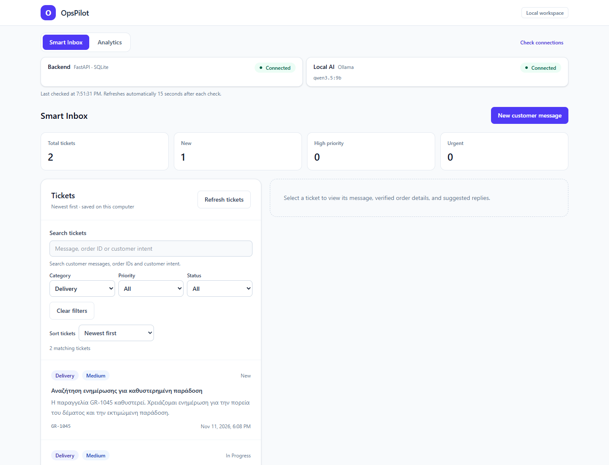
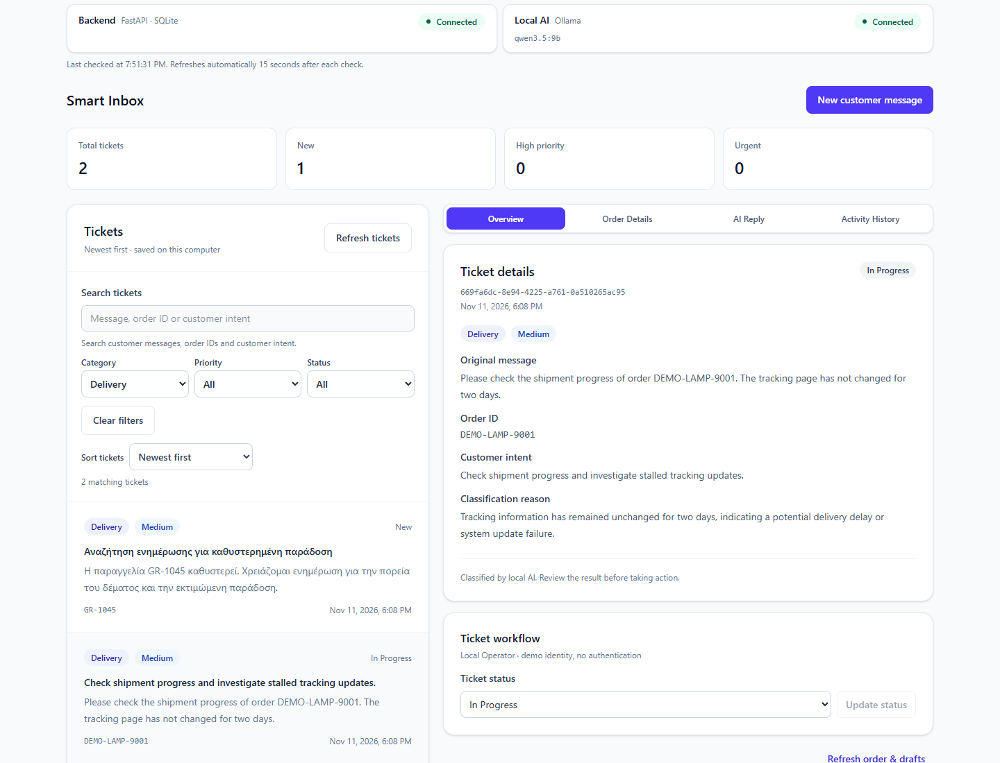
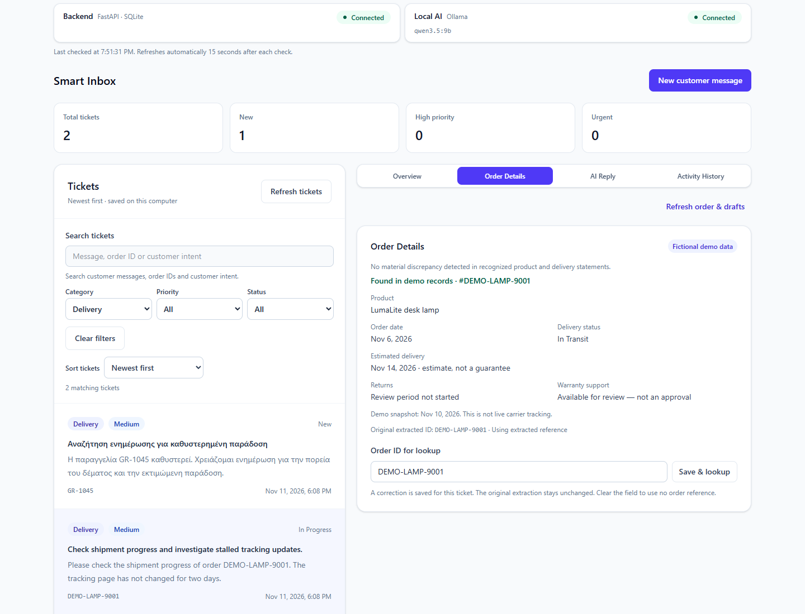
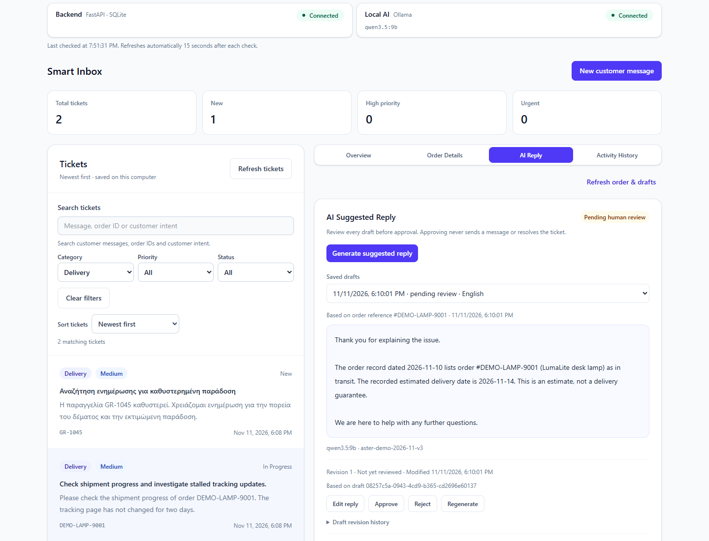
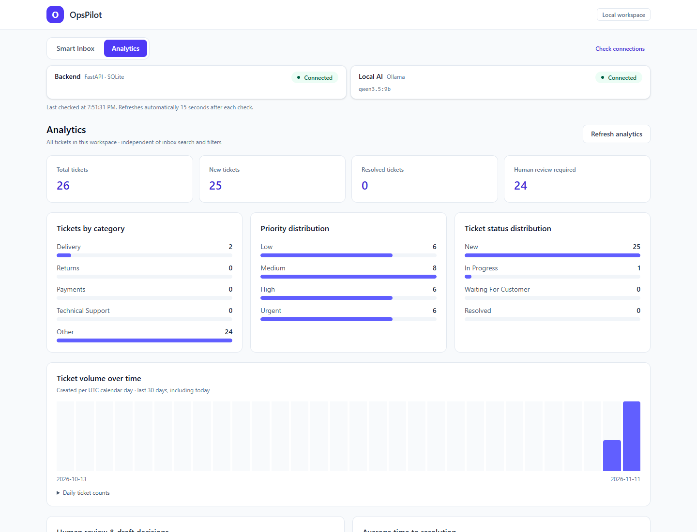
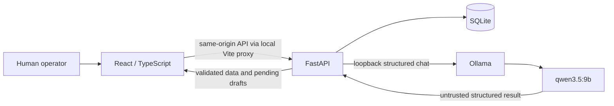

# OpsPilot

A local AI customer-support prototype that classifies English and Greek messages, checks fictional order facts, and prepares reply drafts for human review.

**Status: CONDITIONAL GO for a supervised hackathon demo with fictional data.** This prototype has no authentication, real inbox integration, sending, or payment/refund processing. [Final audit and restrictions](docs/milestone5d/final-quality-report.md).

## The problem

Support involves identifying the issue, assessing urgency, checking orders, reconciling conflicting information and recording who reviewed the answer. OpsPilot brings those steps into a local workspace.

## How OpsPilot works

1. An operator submits a customer message.
2. Local Qwen returns category, priority, order reference, intent and reason as structured output.
3. FastAPI validates the result before saving a ticket in SQLite.
4. Verified fictional orders are compared with recognized product/delivery claims; discrepancies remain visible.
5. Qwen selects a constrained reply plan. Backend templates render verified facts and policy wording.
6. A human reviews, edits, approves or rejects the draft. Approval sends nothing; revisions and activity persist.

The model is one component in a workflow with verified context, server-side checks and human decisions. It has no autonomous action tools.

## Key features

- Greek/English classification into five categories and four priorities.
- Smart Inbox: debounced search, combined filters, sorting, matching counts and pagination.
- Nineteen fictional orders, manual reference corrections and consistency warnings.
- Controlled reply drafting, explicit human review, immutable approved content and pending child revisions.
- Separate ticket status workflow, persistent audit/revision history and local analytics.
- Local Ollama **qwen3.5:9b** inference, without cloud inference APIs or per-request API charges.

## Screenshots

Actual application captures at 1440×1100, using an isolated synthetic QA snapshot. Inbox counts reflect filters; Analytics includes all 26 QA tickets. These are real screenshots, not UI mockups. The screenshot database differs from a fresh live demo.



| Smart Inbox | Order verification |
| --- | --- |
|  |  |

| Human review | Analytics |
| --- | --- |
|  |  |

[Screenshot provenance](docs/milestone6/screenshots/README.md) · [Timed demo script](docs/milestone6/demo-script.md)

## Architecture



[Architecture, data flow and trust boundaries](docs/milestone6/architecture.md).

## Technology stack

| Layer | Implementation |
| --- | --- |
| Frontend | React, TypeScript, Vite, Tailwind CSS |
| Backend | Python, FastAPI, Pydantic, SQLModel / SQLAlchemy |
| Storage | SQLite, additive migrations, workflow/history protection triggers |
| Inference | Local Ollama, qwen3.5:9b, structured outputs, thinking disabled |
| Verification | pytest, Vitest, Testing Library, Playwright with installed Microsoft Edge |

## Quick start — existing installation

Open PowerShell **in the repository root**, using two fresh terminals so previous QA variables do not carry over. These commands use separate demo ports and a separate database. Startup creates an empty ticket database and seeds fictional orders; automated demo writes must never target your normal database.

Backend terminal:

```powershell
$env:DATABASE_PATH = '.cache/milestone6/live-demo.db'
.\backend\.venv\Scripts\python.exe -m uvicorn app.main:app --app-dir backend --host 127.0.0.1 --port 8018
```

Frontend terminal, also from the repository root:

```powershell
$env:BACKEND_URL = 'http://127.0.0.1:8018'
Set-Location frontend
npm.cmd run dev -- --port 5197
```

Open <http://127.0.0.1:5197>. Keep Ollama running at <http://localhost:11434>. Stop servers with `Ctrl+C`. Reusing the database preserves previous demo tickets. Choose a new repository-local filename for a fresh rehearsal instead of deleting data.

## Full local installation — Windows PowerShell

Prerequisites: Windows 11, Git, Python 3.13, Node.js 24 LTS and Ollama with qwen3.5:9b. Obtain runtimes from [Python](https://www.python.org/downloads/windows/), [Node.js](https://nodejs.org/en/download) and [Ollama](https://ollama.com/). Model performance depends on available hardware; the benchmark workstation is not a minimum-hardware guarantee.

From the cloned repository root, for a **new installation**:

```powershell
python --version
node --version
git --version
ollama list
python -m venv backend\.venv
```

Preserve an existing virtual environment. Windows Application Control blocked an optional SQLAlchemy native accelerator on the development machine. Install the same pinned version's official, hash-pinned **pure-Python wheel** in the project environment, then constrained dependencies:

```powershell
.\backend\.venv\Scripts\python.exe -m pip install --no-deps "https://files.pythonhosted.org/packages/a3/1e/6eba6770b626a991e58de306385d414b9f3ae780ae60c61aa1d0841dcaaf/sqlalchemy-2.1.8-py3-none-any.whl#sha256=69aea77b5d8a64e95d01fd7ec54985c84b4a8ef3cac3108e9271145441400c1b"
.\backend\.venv\Scripts\python.exe -m pip install -r backend\requirements-dev.txt
.\backend\.venv\Scripts\python.exe -c "import sqlalchemy; print(sqlalchemy.__version__)"
.\backend\.venv\Scripts\python.exe -m pip check
if (-not (Test-Path .env)) { Copy-Item .env.example .env }
Set-Location frontend
npm.cmd ci
Set-Location ..
```

For an already installed blocked native wheel, use the [project-local repair](docs/milestone6/local-reference.md#sqlalchemy-compatibility). Never disable Windows security protections. No global Python/npm packages are required.

If the model is missing, `ollama pull qwen3.5:9b` downloads it and needs network access/disk space. Start Ollama normally; use `ollama serve` only if no server is already running. Inference stays local. Then follow **Quick start** above.

Root `.env` is optional; process environment values override it. Database paths resolve from the repository root and must remain inside it. The browser accesses backend `/api` routes, never Ollama directly. [Configuration, normal ports, health, APIs and troubleshooting](docs/milestone6/local-reference.md).

## Example support workflow

The final browser audit successfully used this fictional message:

> Please check the shipment progress of order DEMO-LAMP-9001. The tracking page has not changed for two days.

Open **New customer message**, paste it and click **Classify & save ticket**. The audited result was `delivery / medium / DEMO-LAMP-9001`. Review the new output: a fresh run can differ or fail validation. **Order Details** shows a LumaLite desk lamp in transit in the fixed November 10, 2026 snapshot, with a November 14 estimated delivery. This is fictional dated data, not today's tracking or a guarantee.

In **AI Reply**, generate and review the draft; optionally edit/save it and confirm approval. Show **Activity History** and **Analytics**. Approval sends nothing and does not resolve the ticket. [Narration, preflight and failure backup](docs/milestone6/demo-script.md).

## AI quality and benchmark results

Historical synthetic evaluations of particular frozen versions; these are not current production-accuracy claims.

| Evaluation | Category | Priority | Order ID | Accepted complete label tuple |
| --- | --- | --- | --- | --- |
| 5A baseline, original 60 (30 EN / 30 EL) | 48/60 | 45/60 | 49/60 | 43/60 (71.67%) |
| 5B development, same original 60 | 57/60 | 58/60 | 57/60 | 56/60 (93.33%) |
| 5B previously unseen 40 (20 EN / 20 EL) | 40/40 | 39/40 | 40/40 | 39/40 (97.5%) |

“Complete” means category/priority/order-ID exact match plus pipeline acceptance, not all summary/reply semantics. The held-out set was authored by the implementer, not an externally blinded evaluator. Eleven English held-out summaries were initially Greek despite correct tuples. 5C added language constraints and physical-hazard urgency checks: all 11 named diagnostics then had English summaries, but only 9 were accepted; two still failed narrative validation. Fresh 5C populations achieved 20/24 initially and 7/8 on the final revision, with raw language checks 24/24 and 8/8. Do not merge different populations/implementations or reuse them as a new holdout.

5D passed **297 backend / 78 frontend tests**, TypeScript/build checks and a further 34 focused regressions. Nine new real-Qwen classifications yielded **8/9 accepted exact label matches**. Nine reply plans generated, but the physical-danger reply failed semantic usefulness review. Deterministic checks do not prove useful or safe answers.

5D nine-case median pipeline times were **0.999 s classification** and **0.752 s reply planning**; classification ranged 0.739–4.599 s including model-load effects. Hardware, loading and small sample size matter; no speed guarantee is made.

[Benchmark summary and caveats](docs/milestone6/benchmark-summary.md) · [5A](docs/milestone5/report.md) · [5B](docs/milestone5b/report.md) · [5C](docs/milestone5c/report.md) · [5D](docs/milestone5d/final-quality-report.md)

## Safety and human oversight

Messages and AI output are untrusted. Schemas, Pydantic, evidence-bound IDs, summary checks and a constrained renderer reject recognized invalid/unsupported output. Unknown/disputed facts stay uncertain. No invented fallback result is substituted when inference fails.

Server-side confirmation, versions, context checks and short transactions enforce workflow decisions. Approved content is immutable; editing creates a pending child. Revisions and audit events persist. These supplement human judgment; they neither authenticate **Local Operator** nor prove arbitrary prose safe.

## Known limitations

- **HIGH:** Physical-danger cases can be correctly urgent yet receive inappropriate routine returns guidance. Do not approve or use those replies.
- **MEDIUM:** Some ordinary returns fail narrative validation and save no ticket.
- **MEDIUM:** Relevance, naturalness, implicit contradictions and adaptive injection require human evaluation. Language selection is a Greek/Latin script heuristic.
- No authentication, tenant isolation, real order synchronization, sending, refunds or production deployment package.
- Static fictional orders/policies; one inference at a time per backend process, no durable queue or automatic mutation retries.
- Synthetic tests establish neither production accuracy nor legal compliance/certification.

## Production roadmap — future work

The [production scaling roadmap](docs/milestone6/production-roadmap.md) separates safety gates, a secure single-company pilot, authorized integrations, tenant isolation, scalable inference, enterprise operations and commercial validation. Prefer a modular monolith; scale from measured demand. The roadmap is **not implemented**.

## Project status

Milestones 1–6 deliver a supervised prototype and an evidence-backed launch package. [Release checklist](docs/milestone6/release-checklist.md), [pitch](docs/milestone6/pitch.md) and [judges' Q&A](docs/milestone6/judges-qa.md) identify pending operator rehearsal/publication work. Coding agents wrote implementation/tests/documentation; the human product owner defined scope, constraints and tested/reviewed the product. No adoption, revenue, time-saving or certification claim is made.

Run deterministic tests/build from the repository root:

```powershell
.\backend\.venv\Scripts\python.exe -m pytest backend/tests -q
Set-Location frontend
npm.cmd test
npm.cmd run build
```

No expensive AI benchmark rerun is needed for this documentation milestone. Historical smoke scripts can write to their configured backend: use the exact isolated QA setup, never the normal database. See [local reference](docs/milestone6/local-reference.md).

## License status

No project license file is present. The owner must choose/add one before claiming open-source licensing or general reuse rights. Dependency/model licenses are separate and need review before distribution or commercial use.
