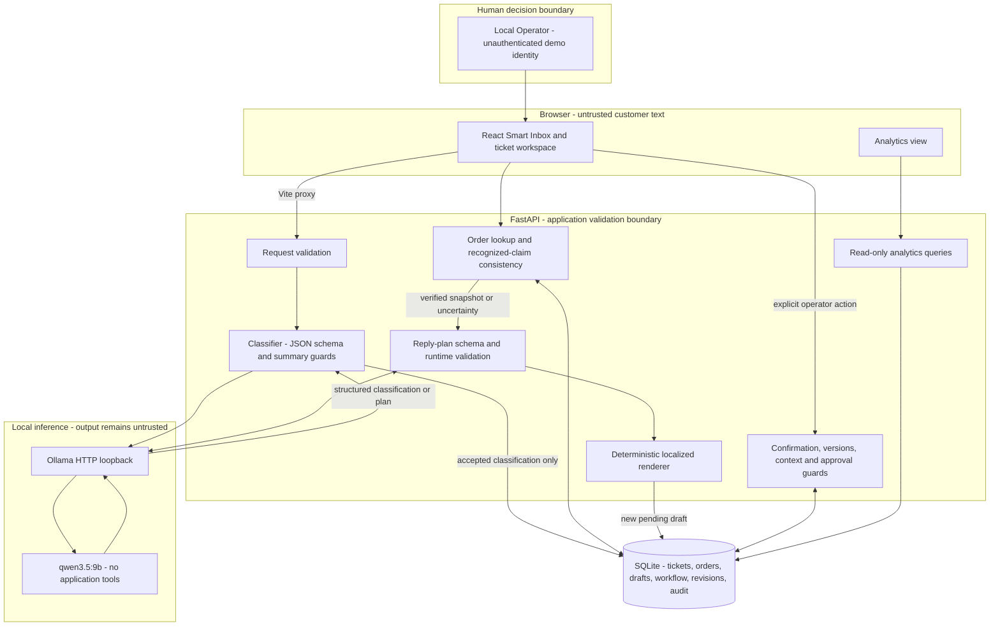

# Architecture — implemented prototype

This describes the checked-in local application, not the [future production roadmap](production-roadmap.md). Entrypoints: `frontend/src/main.tsx` → `App.tsx`; `backend/app/main.py` → `create_app()` / `app`. Vite proxies same-origin `/api` to FastAPI. SQLite and Ollama are accessed only from the backend.

No email, ecommerce or payment service appears because none is connected. The Vite proxy is a local development/preview convenience, not an authenticated production gateway.

## Ticket processing and classification

`tickets.py` validates nonempty messages up to 5,000 Unicode characters. The original message is preserved. A process-local asynchronous lock rejects concurrent inference with 429; no database write transaction is held during model inference.

`classifier.py` sends JSON-encoded customer data separately from system rules to `/api/chat`, using `qwen3.5:9b`, `think: false`, non-streaming structured output, temperature 0 and seed 42. It restricts enums and order candidates. `customer_data.py` conservatively masks explicit control spans for candidate/language checks; this finite preprocessing is not a complete injection boundary. The original message still reaches Qwen as untrusted data.

Pydantic checks structure/types; additional guards check completion, tools, supported order references, summary length, repetition, gendered/customer-narrative wording, selected language and recognized physical-hazard urgency. A narrow physical-hazard recognizer can constrain the generation priority to urgent; it does not catch every possible phrasing. The category/priority can still be semantically wrong even when accepted.

Only validated classifications reach `save_ticket()`, which writes the ticket, workflow state and creation event in one transaction. AI failure creates neither a substitute classification nor an unclassified ticket.

## Order verification

`orders.py` seeds 19 fictional orders by insert-if-missing only. `7821` is the delivered smartphone in a fresh seed; `DEMO-LAMP-9001` is the separate in-transit lamp. Historical existing rows are not overwritten. All fixtures refer to the fixed November 10, 2026 snapshot.

`TicketOrderReference` preserves a manual override separately from the immutable original extracted reference. Effective lookup returns found/unknown/not-provided. `consistency.py` compares recognized English/Greek product and delivery assertions, flagging mismatches and competing statements. An absence of detected discrepancy is not proof of agreement; implicit possession or unfamiliar wording can be missed.

Discrepancies, unknown orders and absent references require human review. A context fingerprint captures the effective reference/order/consistency basis. Correcting a reference invalidates stale approval assumptions. Human documentation records a decision but does not verify disputed facts or erase warnings.

## Controlled drafting

`reply_generator.py` supplies the original untrusted message, verified order snapshot/uncertainty and seven fictional policies. Qwen chooses a `ReplyPlan`: language, opening, optional fact keys, fixed information-request step and closing. It does **not** freely write the final customer-facing prose. The backend validates the plan and `render_reply()` assembles localized approved wording plus verified values.

Required facts cannot be omitted by selecting fewer optional keys. Known delivery estimates are qualified; missing estimates remain unknown. Disputed product/status/date facts are excluded and clarification requested. Eligibility supports review, never refund approval or a completed action. Finite security-specific guidance exists; the missing physical-emergency reply path remains a HIGH limitation.

`drafts.py` checks current context again in a short write transaction after inference, refusing stale-context saves. Each original draft snapshot stores text, model, policy version, language, timestamp and order basis. New drafts remain pending review. There is no fallback text on model/validation failure.

## Human workflow and persistence

`workflow.py` enforces explicit confirmation, expected versions, context fingerprints, allowed transitions and server-side content/review checks. UI controls are not the authorization boundary. This is an unauthenticated local operator workflow: anyone able to access the API can act as Local Operator.

- Pending edits produce revisions; original generated snapshots are retained.
- Editing approved/rejected content creates a separate pending child draft.
- Approval/rejection records the displayed saved version; duplicate/stale decisions fail.
- Approval neither sends a message nor changes ticket status.
- Status moves independently through new, in-progress, waiting-for-customer and resolved/reopened transitions.
- Audit/revision/documented-review rows are append-only through the application and protected by SQLite triggers. Approved review rows and original draft snapshots have mutation protection.

Original `ticket.status`/`replydraft.status` remain historical snapshot fields; `ticketworkflow.status`/`draftreview.status` hold current authoritative states. This distinction prevents unsafe legacy-table replacement. Workflow writes use short `BEGIN IMMEDIATE` transactions and concurrency/version checks. Local database administrators can still tamper with files/triggers; this is not authenticated, cryptographically tamper-proof evidence.

`migrations.py` performs additive schema/backfill changes with consistent SQLite backups before upgrading an existing legacy database. It marks imported history rather than inventing historical human actions. Foreign keys are enabled per connection.

## Inbox and analytics

`TicketDashboard.tsx` combines search/filter/sort before API pagination. Search debounces 300 ms; changes reset pagination. Aborted/stale requests cannot overwrite newer results. ORM expressions bind values and escape search wildcards. Matching counts use the same conditions; manual references are searchable. SQLite's default case-insensitive behavior does not guarantee Greek case folding.

`analytics.py` uses the configured database only, reporting all-ticket category/priority/status totals, derived review flags, current approved/rejected draft counts, UTC-day creation volume and eligible current-resolved intervals. Inbox filters do not change Analytics. No AI is used for these calculations.

## Trust boundaries and safe failure

| Boundary | Existing control | Remaining limit |
| --- | --- | --- |
| Customer text → UI/API/model | Escaped React text, validated input, explicit untrusted prompt data | Valid-looking prose can still influence semantic classification |
| Qwen → backend | Schema, Pydantic, evidence/summary/plan checks | Cannot prove intent, priority or helpfulness correct |
| Verified context → draft | Backend-derived material, constrained renderer, context recheck | Synthetic snapshot and finite discrepancy vocabulary |
| Operator → approval | Confirmation/version/context/content checks | No authenticated role or complete semantic proof |
| Backend → Ollama | HTTP loopback-only configuration; proxy environment ignored; redirects disabled | Local model latency/availability still matters |
| Application → SQLite | Parameterized queries, transactions, foreign keys, history triggers/backups | No encryption/key management, tenancy or administrator protection |

Model unavailable→503; malformed/unsupported output→502; inference timeout→504; busy→429; stale/version/order change→409; known storage failure→503. Original records stay readable when Ollama is offline. Requests are not automatically retried. If a browser loses a write response, refresh before resubmitting to avoid duplicates.

Mixed-language rule: compare Greek/Latin letters in the first 500 remaining prose characters after explicit control spans, URLs/emails and digit-bearing identifiers are excluded. Greek wins a tie with at least three Greek letters; otherwise English. Verbatim permitted names/identifiers may remain in localized prose. This is a script heuristic, not comprehensive language identification.

[Final audit and remaining issues](../milestone5d/final-quality-report.md) · [Setup/API reference](local-reference.md)
